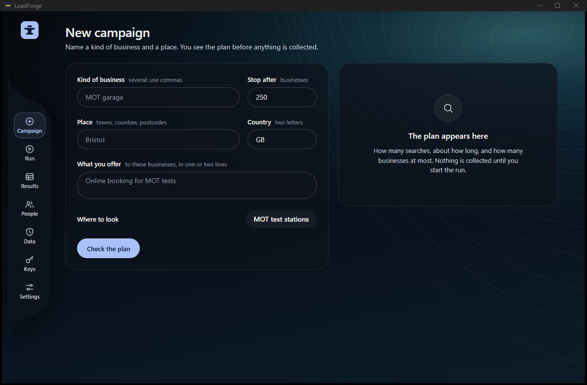
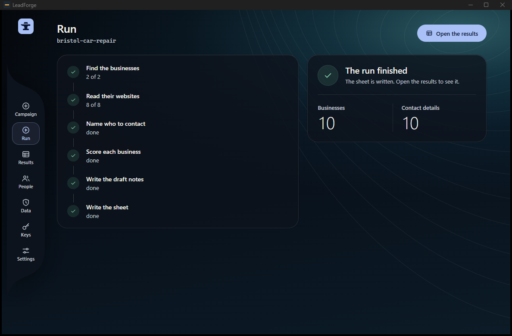
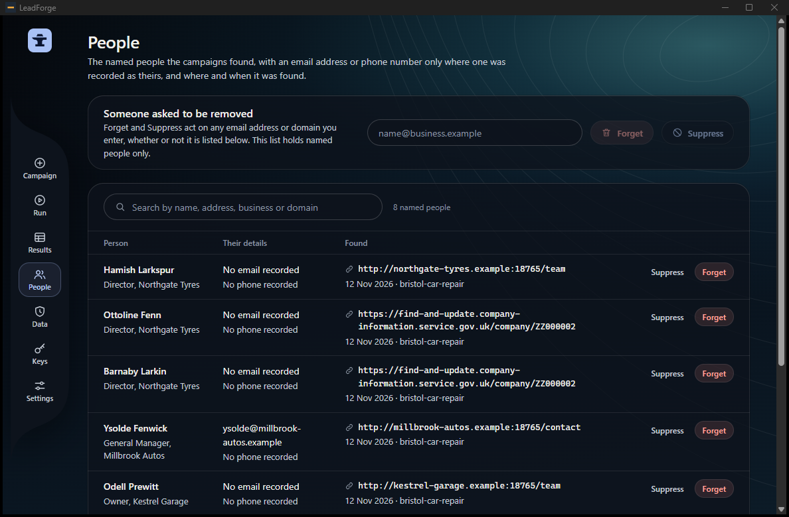
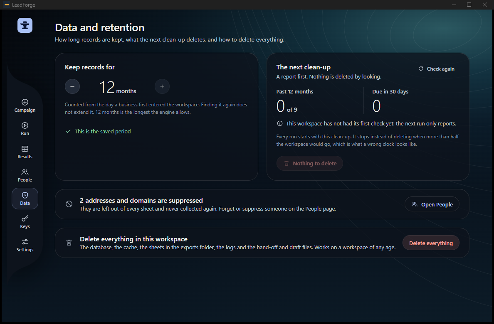

# The window

The LeadForge window is a Windows desktop app: a Rust core (Tauri 2) and React screens. It starts the Python engine and nothing else. It has seven
screens. It has no send or outreach action, and a Rust test fails if the permission files grant anything outside a fixed list.

The window never opens the database, a file or the network itself. Each action is one method of `app/ui/src/engine.ts`; inside the app that method is one
call to the core; the core runs `leadforge window <name>` in the workspace folder with the arguments as one JSON document on stdin, and passes the one
JSON document it prints on stdout back to the screen. `leadforge window <name>` is the engine's side of that seam. It is not for typing: it takes no
arguments on the command line. The contract, the time limits and the error kinds are in [`window-actions.md`](window-actions.md). The slices that built
the window are [`slices/L10-shell.md`](slices/L10-shell.md), [`L11-window.md`](slices/L11-window.md) and [`L11a-window-commands.md`](slices/L11a-window-commands.md).

The pictures on this page were taken from the window running the real engine on an invented campaign: made-up business names, `.example` addresses.

## What the core does and does not do

- It starts one program, the bundled `python.exe`, as `-X utf8 -I -m leadforge window <name>`, with an environment cleared down to a short fixed list of Windows variables (no key reaches it), no console window and stdin closed after the one document.
- One engine at a time, except `run_stop` and `run_status`, which run beside a run.
- The workspace folder is `%LOCALAPPDATA%\app.leadforge.window\workspace`. It cannot be changed from the window.
- One copy of the app at a time: a second copy brings the first to the front and ends.
- Limits: 1 MiB of arguments in, 8 MiB out, 64 KiB per progress line. A run may last 12 hours; the data commands 30 seconds to 10 minutes, each pinned in the core.
- The page carries a content security policy that allows no remote resource, no inline script and no network address but the core's own.

## The seven screens

Screen names are those of the side rail: Campaign, Run, Results, People, Data, Keys, Settings. About is a tab of Settings.

### 1. Campaign

The form: kinds of business (several, separated by commas), stop after N businesses, places, country (two letters), what you offer (one or two lines), and
where to look (the registers the workspace is set up for; one is shown as text). For Companies House the form also asks for SIC codes.

| Action | Engine command | What it does |
|---|---|---|
| Check the plan | `campaign_create` | checks the form, writes `campaigns\<place>-<kind>\answers.yaml`, `icp.yaml` and `window.json` in the workspace, and answers with the plan: searches, estimates, warnings, the retention period. Nothing is collected. |
| Start the run | `run_start` (see Run) | starts the campaign that was planned |
| Change how long it is kept | none | goes to the Data screen |

An incomplete form is refused (error kind `input`) and each problem is shown on its own field: no kind, no place, no country, no offer, no SIC code for
Companies House, a register the workspace is not set up for. A register campaign's plan reads "up to the cap" with no time, because the engine does not count a register before the run.

### 2. Run

Six stages: find the businesses, read their websites, name who to contact, score each business, write the draft notes, write the sheet. The current stage shows its
count, a bar and the last message, and the time left when it is known. A clean-up line says how many records the start-of-run clean-up deleted and how many expire in the next 30 days (left out when the engine did not count).

| Action | Engine command | What it does |
|---|---|---|
| Start the run, Continue the run | `run_start` | runs the engine's own pipeline (`pipeline.run_pipeline`, the path `leadforge run --detach` takes) and streams progress as JSON lines. The clean-up of [`data-and-deletion.md`](data-and-deletion.md) runs first; a clean-up that stops for "more than half" ends the start with its own message. "Continue" resumes the same campaign where it stopped. |
| Stop the run | `run_stop` | writes a stop flag; the run ends between two businesses with its place kept. The core gives the engine 90 s to write its end event, then ends it. |
| (when the screen opens, and after a lost stream) | `run_status` | reads the run's state: running, finished, stopped or failed |
| Open the results | none | goes to Results |

A start the engine refuses shows "start refused" with its message. When a run's engine ends without saying how, the screen asks `run_status` once and shows
what it says, or "The engine stopped without saying why." and "Continue the run".

### 3. Results

| Action | Engine command | What it does |
|---|---|---|
| (the list) | `campaigns_list` | every campaign of the workspace, newest first, with its counts, tiers, register and "Kept until" date |
| Write it again | `sheet_export` | writes the sheet of a run again (`leadforge export`): the `.xlsx`, a `.csv` copy if Settings asks for it, and `report.json`, under `leadforge_data\exports\<run>\` |
| Open the sheet | `sheet_open` | opens a file in the program Windows uses for it; the engine refuses a path outside `exports` (also through `..` or a link) |

A field the engine does not know shows "not recorded", not a guess. "Kept until" is left out when there is no start time.

### 4. People

The named people the campaigns found, with an e-mail address or phone only where one was recorded as theirs, and the page and day it was found. Search by name,
address, business or domain (up to 500 rows a page). Businesses' general addresses (`office@...`) are not listed.

| Action | Engine command | What it does |
|---|---|---|
| Forget (on a row, or on any address, domain or name typed in the box) | `person_forget` | `leadforge forget <value>`: see [`data-and-deletion.md`](data-and-deletion.md). The confirmation stays open until done; a file that could not be cleaned is named and nothing is called forgotten. |
| Suppress (on a row, or on any address or domain typed in the box) | `address_suppress` | `leadforge suppress add <value>`; the value is left out of every sheet and not collected again |

### 5. Data

| Action | Engine command | What it does |
|---|---|---|
| the months control | `retention_get`, `retention_set` | reads and sets `retention.months` (1 to 12; shorten only) |
| Check again | `purge_report` | `leadforge purge`: what the next clean-up would delete; changes nothing |
| the delete button of "The next clean-up" | `purge_apply` | `leadforge purge --apply`. On a workspace that has not been checked yet it only arms and reports. Disabled and reading "Nothing to delete" when nothing is past the limit. |
| Delete everything | `purge_everything` | `leadforge purge --everything --yes`; the engine refuses it without `"confirm": true` |

### 6. Keys

Two keys: the Companies House key and the OpenCorporates token. The screen shows whether each is saved, never the value, and says "Saved, but this workspace is set not to
read the keyring" when `registry.keyring` is off (the screens have that wording; the engine's side is on the separate branch `slice/L11a-follow`, not merged here, see [`limits.md`](limits.md)).

| Action | Engine command | What it does |
|---|---|---|
| (the list) | `keys_list` | which keys are saved in the Windows keyring |
| Save | `key_save` | stores the value in the keyring under service `leadforge`, entry `registry.<name>` |
| Remove | `key_remove` | deletes the entry |

**Today the installed window cannot keep a key.** The `keyring` package is in neither hashed lock, so the bundled engine has none, and the screen says "Keys cannot
be kept in the keyring on this computer". Use an environment variable ([`configuration.md`](configuration.md)). Proven by the install run of slice L11; the keyring itself was never exercised.

### 7. Settings

| Action | Engine command | What it does |
|---|---|---|
| (read) | `settings_get` | the workspace folder (shown as text), the sheet formats, "open when a run finishes", the registers switched on |
| Also write a CSV copy, Open the sheet when a run finishes | `settings_set` | writes `export.formats` and `export.auto_open` to `leadforge.yaml` after the file is checked |
| Theme and accent | none | kept by the window itself in the browser storage of its page; the engine never sees them |
| About and licences (tab) | `about` | the engine's version and the licence notices of every bundled package; the window's own version is a constant built from `app/src-tauri/Cargo.toml` |

## Errors

Every failure comes back as `{kind, message, details, next}`. The kinds follow the engine's exit codes: `failed` (1), `usage` (2), `environment` (3), `input` (4),
`source` (5, a register did not answer), `keyring`, `missing` (the engine lacks the command). The screens show the engine's own words.

## Install

See the README, "Install, the Windows app". Build and proof steps are in [`development.md`](development.md).
